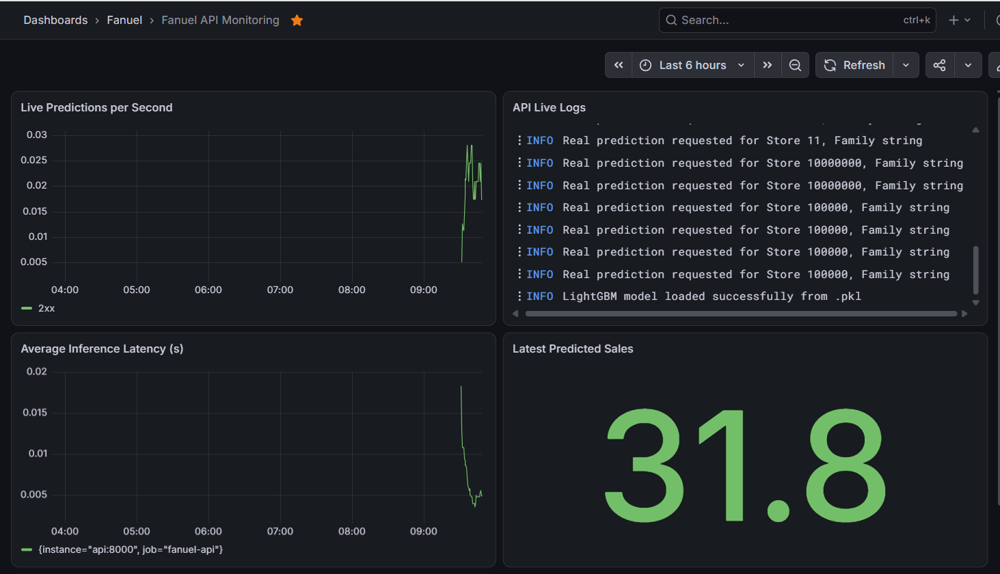
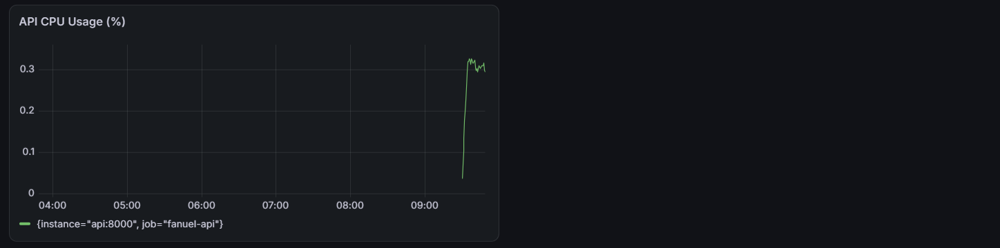
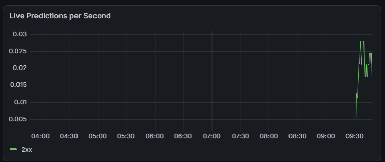
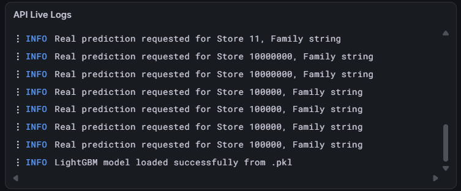
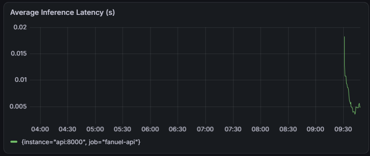
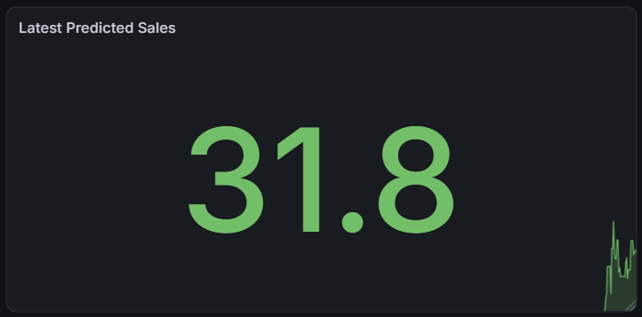
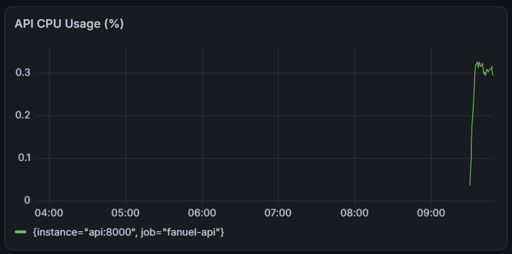

#  Grafana Observability Dashboard Report

## 1. Introduction
To satisfy the application logging and monitoring requirements of the MLOps practical, a fully containerized observability stack was deployed using **Prometheus** (for metrics), **Loki** (for logs), and **Grafana** (for visualization). The FastAPI model service was instrumented to expose key performance indicators, allowing for real-time monitoring of the machine learning pipeline.

The dashboard consists of five core **Telemetry Visualizations** designed to monitor API traffic, system health, and ML-specific metrics. 

---

## 2. Dashboard Overview

Below is the complete, live Grafana dashboard capturing real-time API traffic, system metrics, and Loki logs during a batch prediction test.

---

## 3. Telemetry Visualizations

### 3.1: Live Predictions per Second (Traffic)

*Tracks the request rate hitting the prediction endpoint.*
*   **Data Source:** Prometheus
*   **Query:** `sum(rate(http_requests_total{handler="/predict"}[5m])) by (status)`

This time-series visualization calculates the per-second rate of requests made to the `/predict` endpoint over a 5-minute rolling window. It is grouped by HTTP status code (e.g., `2xx` for success). In the screenshot, we can observe a distinct spike reaching approximately 0.03 requests per second, indicating successful batch testing of the API.

---

### 3.2: API Live Logs (Observability)

*Real-time log aggregation for debugging and auditing.*
*   **Data Source:** Loki
*   **Query:** `{application="fanuel-api"}`

This log-streaming widget streams structured logs directly from the FastAPI application. It successfully captures events such as individual inference requests (`INFO Real prediction requested for Store 11...`) and system startups (`INFO LightGBM model loaded successfully from .pkl`). Monitoring logs in real-time allows developers to instantly debug errors or trace the flow of requests.

---

### 3.3: Average Inference Latency (s) (ML Performance)

*Monitors the time it takes for the model to generate a prediction.*
*   **Data Source:** Prometheus
*   **Query:** `rate(model_prediction_latency_seconds_sum[5m]) / rate(model_prediction_latency_seconds_count[5m])`

For ML models, latency is a critical SLA (Service Level Agreement) metric. This visualization calculates the average time the LightGBM model takes to process a feature vector and return a prediction. The graph shows the latency spiking and then settling down to approximately **0.005 seconds (5 milliseconds)**. Because LightGBM is highly optimized, the latency is extremely low, ensuring the API can handle high-throughput requests without bottlenecking.

---

### 3.4: Latest Predicted Sales (Model Output)

*Displays the most recent output from the ML model.*
*   **Data Source:** Prometheus (Custom Gauge)
*   **Query:** `model_prediction_value`

This statistical widget displays the latest predicted sales value generated by the model. The live test shows sales prediction of **31.8 units**. Monitoring the output distribution is essential for catching **Data Drift** or **Concept Drift**. If the model suddenly starts predicting `0.0` or `10,000.0` consistently, it indicates a problem with the incoming data.

---

### 3.5: API CPU Usage (%) (Resource Monitoring)

*Monitors the container's hardware resource consumption.*
*   **Data Source:** Prometheus
*   **Query:** `rate(process_cpu_seconds_total{job="fanuel-api"}[5m]) * 100`

This instrumentation component tracks the CPU utilization of the FastAPI Docker container. During the batch test of 10+ predictions, the CPU usage spiked to approximately **0.3%** before stabilizing. Monitoring system resources is vital for autoscaling and cost management. If CPU usage consistently hits high thresholds, it indicates the service requires more replicas.

---

## 4. Automated Provisioning (MLOps Best Practice)
To ensure reproducibility, the dashboard and data sources are automatically provisioned using YAML configuration files (`datasources.yml` and `dashboards.yml`). 

This means that if we run `docker compose up`, we don't need to manually rebuild this dashboard. It mounts the `grafana_dashboard.json` directly into the container, fulfilling the MLOps requirement for automated deployment and Infrastructure as Code (IaC).

## 5. Conclusion
By implementing Prometheus, Loki, and Grafana alongside custom ML metrics (latency and prediction distribution), the system achieves full observability. The dashboard allows for proactive monitoring of both the software infrastructure and the machine learning model's behavior in a production-like environment.